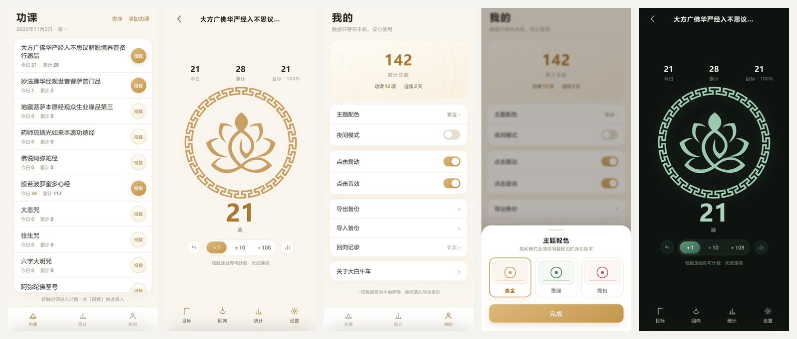

# 大白牛车 · 读经计数器

一个安静的 Android 读经 / 持咒计数器。纯本地运行，不联网、不登录、不收集任何数据。
个人自用项目，桌面图标与计数页图案取自参考图的「回纹圆环 + 坐禅人形莲花」徽章。



## 功能

- **功课列表**：内置 12 个常见功课名（心经、大悲咒、普门品、圣号、磕大头…），可自由增删排序；页首与页脚固定，只滚中间列表
- **计数页**：`+1` / `+10` / `+108`、长按连续计、误点可撤销，可设每日目标
- **报数**：一次录入 N 遍，支持手输与快捷值
- **统计**：按月 / 按年 / 累计的柱状图，点柱可直接改数
- **我的**：主题配色（素金 / 墨绿 / 霞粉，各有日间与夜间两套）、点击震动、点击音效、导出导入备份、回向记录

数据全部存在本机 `localStorage`，换机时用「导出备份」生成 JSON 再导入。

## 构建 APK

免 Gradle、免 Android Studio，一条脚本出包：

```bash
bash android/build_apk.sh --genkey   # 首次：生成签名密钥（android/jingke.jks）
bash android/build_apk.sh            # 日常：出包到 dist/大白牛车-v1.0.0.apk
```

依赖：

| 依赖 | 用途 |
| --- | --- |
| Android SDK build-tools 34.0.0 | aapt2 / d8 / zipalign / apksigner |
| `platforms/android-34/android.jar` | 编译期类库 |
| 本机 JDK 8 | javac（`-source 8 -target 8`） |
| `tools/jdk-17.0.20.1+1-jre` | 只给 d8 / apksigner 用，需自行下载到该路径 |

签名密钥 `android/jingke.jks`、口令 `android/keystore.pass` 不入库，**请单独备份**——换签名会导致无法覆盖安装、旧数据丢失。

## 目录

```
web/                    前端（纯 HTML/CSS/JS，浏览器直接打开即可预览）
android/project/        原生壳：WebView + 状态栏/导航栏跟随主题
android/build_apk.sh    一键打包
android/make_icons.py   从参考图生成各密度启动图标与自适应图标
backups/                历史设计留档（线描莲方案、抠图原始素材）
shots/                  本地验证脚本（无头 Chrome 截图、布局自检）
dist/                   构建产物
```

## 一些实现备注

- 包名保留 `com.jingke.counter`（项目最早叫「净课」），为的是同签名覆盖安装能原地升级、不丢数据
- 前端用 `shouldInterceptRequest` 把 `https://appassets.androidplatform.net` 映射到 assets，保证 WebView 里 `localStorage` 稳定持久
- 徽章是把参考图逐像素提墨、二值化、再用 vtracer 矢量化得到的单色路径，跟随主题色变化
- 三套配色由 `html[data-theme]` × `html[data-accent]` 两组属性驱动，共 6 套变量
